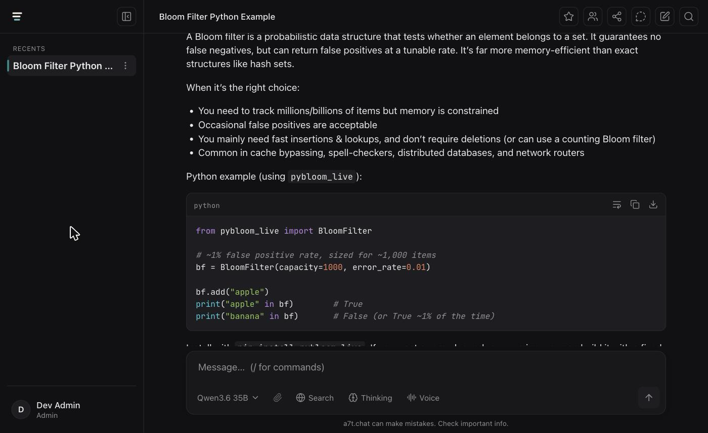

<p align="center">
  
</p>

<p align="center">
  <picture>
    <source media="(prefers-color-scheme: dark)" srcset="brand/lockup-horizontal-dark.png">
    <source media="(prefers-color-scheme: light)" srcset="brand/lockup-horizontal-light.png">
    
  </picture>
</p>

<p align="center">
  A fast, tasteful, self-hostable AI console. Local-first, passkey auth, shareable live sessions.
</p>

<p align="center">
  <a href="LICENSE"></a>
  
  
</p>

---

**a7t.chat** is a self-hostable, multi-model chat console you actually want to live in. It streams
fast, it looks good, and it runs entirely on your own machine by default: point it at any
OpenAI-compatible model and nothing leaves the box. When you want more, it grows with you, with
passkey accounts, bring-your-own frontier keys, file uploads, and live shareable sessions.

The design bet is simple: speed and taste first, then depth. Instead of racing to match every
feature the big labs ship, a7t.chat focuses on being genuinely nicer to use, and on the one thing
the giants do poorly, live no-login collaboration.

<p align="center">
  
</p>

## Highlights

- **Streaming multi-model chat.** Rich markdown, model switching with `/model`, and generations
  that survive a client disconnect (they run on a server-side queue, not the HTTP request).
- **Capabilities.** Focused, in-chat tools rather than separate apps:
  - **Maps** for places and directions.
  - **Recipes** that format a dish as a shopping checklist plus timed steps, with self-contained
    countdown timers that chime when they finish.
  - **Research**, web search that fetches live, cited context before a turn so any model answers
    from fresh sources.
- **Local-first.** Talk to a local, OpenAI-compatible model through `JANO_URL`. In this mode
  nothing leaves your machine.
- **Bring your own key (optional).** Plug in your own frontier-provider API keys and run turns on
  your own key and cost. Keys are encrypted at rest and never leave the box except into a turn.
- **File uploads.** Per-account attachments delivered into the prompt, with per-file and
  per-account quotas.
- **Shareable live sessions.** Conversations are private by default. Opt in and mint an
  unguessable link that anyone can watch build in real time with no sign-up, or invite another
  account into a live collaborative session.
- **Passkey auth.** Passwordless, phishing-resistant WebAuthn sign-up and sign-in.

## What it can do

The full surface, by area. Anything marked *optional* stays dark until you configure it, and
nothing here phones home.

### Chat

| Capability | What it does |
|---|---|
| Streaming responses | Markdown renders as it streams. Turns run on a server-side queue rather than the HTTP request, so they survive a reload, a closed tab, or a dropped connection. |
| Model switching | Pick the model per conversation from the composer picker or with `/model`. The picker has search, tier filters, and per-model favorites. |
| Reasoning display | Models that reason show their thinking in a collapsible block above the answer. |
| Thinking toggle | Ask a reasoning model to think before it answers, per turn. |
| Regenerate and variants | Retry an answer and page back and forth through the alternatives. |
| Continue | Pick a reply back up when it stopped early instead of asking again. |
| Branch | Fork the conversation at any message into a new one, so you can chase a tangent without touching the original thread. |
| Edit and resend | Rewrite one of your own messages and run the turn again. |
| Vote | Mark an answer good or bad. |
| Read aloud | Have a reply spoken, using the browser's own speech synthesis. |
| Stop | Interrupt a generation mid-stream. |
| Temporary chat | A ghost conversation that is never persisted. Nothing is written down and memory is not touched. |
| Recap | A resume card for a thread you left: where it ended and what the next step was. |
| Compaction | When a conversation approaches the context limit, compact it in place and keep going. |
| Code and table blocks | Syntax highlighting, copy, download (tables export to CSV), line-wrap toggle, and fullscreen. |
| Task lists | Markdown checkboxes are really tickable, and the state syncs live to everyone watching. |
| Minimap | A scrubbable preview strip of the whole thread pinned to the edge, like a code editor's. |

### Conversations

| Capability | What it does |
|---|---|
| Auto-titling | New conversations name themselves from the first exchange. You can rename or regenerate the title. |
| Organize | Star, rename, and delete from the sidebar. |
| Command palette | One shortcut to jump to any conversation, switch theme or language, open settings, or run a recap. |
| Keyboard shortcuts | The whole app is drivable from the keyboard, and every binding is rebindable (with conflict detection and a reset). |

### Sharing and collaboration

| Capability | What it does |
|---|---|
| Public share link | Conversations are private by default. Opt in and mint an unguessable `/s/<slug>` link that anyone can open, with no sign-up, and watch the answer build in real time. |
| Shared checklists | Watchers on a shared page can tick the task-list boxes. That is the only thing a public visitor can write. |
| Invite an account | The identity-bound share: invite a specific person to the same conversation, revocable at any time. |
| Collaborator roles | `view` and `suggest` can read and watch live, `edit` can tick shared checkboxes, and `prompt` can send turns into the conversation. |
| Collaborative prompting | A `prompt` collaborator's turn runs on the owner's conversation, while their own quota and model allowlist still apply. Neither person's private memory leaks into the other's. |

### Memory

| Capability | What it does |
|---|---|
| Durable facts | High-signal things worth remembering are kept across sessions and injected into later conversations. |
| Rolling summary | Long threads keep a running summary so the far past stays usable. |
| Semantic recall | Relevant moments from your other conversations are found by meaning, not keywords. |
| See and forget | A panel lists everything remembered about you. Forget one fact, or forget all of it. |
| Off switch | Turn memory off and the app stops both reading and writing it. |

### In-chat capabilities

| Capability | What it does |
|---|---|
| Maps | Ask about a place, a trip, or directions and get a real map in the thread. |
| Recipes and timers | A dish comes back as a shopping checklist plus timed steps, each with a countdown chip that chimes and notifies when it finishes. The timers work on the public share page too, with no login. |
| Research *(optional)* | Web search that fetches live, cited sources before the turn, so any model (including a small local one) answers from current information. Needs a provider: Tavily, Brave, or a self-hosted SearXNG. |
| Suggestions | When a conversation wanders near a capability you are not using, one quiet, dismissible chip points at it. Never more than one, never again once dismissed. |

### Files and input

| Capability | What it does |
|---|---|
| Attachments | Attach files from the composer or drag them onto it. Text-like files are delivered into the prompt; the transcript keeps showing them after a reload. |
| File manager | Browse, download, and delete your own uploads, under per-file, per-account, and file-count quotas. |
| Voice input | Record a message and have it transcribed, through any OpenAI-compatible transcription endpoint. |
| Live dictation *(optional)* | Text streams into the composer as you speak. Needs a streaming speech-to-text endpoint. |

### Models and providers

| Capability | What it does |
|---|---|
| Any OpenAI-compatible endpoint | Point `JANO_URL` at llama.cpp, Ollama, vLLM, [Jano](https://github.com/a7t-ai/jano), or anything else that speaks the protocol. |
| Guided setup | `bun run setup` reads your hardware, recommends a model that will actually run on it, downloads it, serves it, and verifies a clean streaming turn. |
| Model catalog | The picker shows what each model can take (text, images, audio), so the composer can tell you when the active model cannot read an attachment. |
| Bring your own key *(optional)* | Store your own frontier-provider keys, encrypted at rest, and run a turn on your own key and cost. You supply a key, never a URL, so there is no request-forgery surface. |

### Accounts and access

| Capability | What it does |
|---|---|
| Passkeys | Passwordless, phishing-resistant WebAuthn sign-up and sign-in, implemented directly against `node:crypto` with no auth dependency. Add several devices per account. |
| Single owner | The first sign-up on the private path becomes the owner. Nobody can self-promote later, and a request arriving through a public edge is never treated as the owner. |
| Handles and directory | Claim a public `@handle` and find other people on the instance, which is how collaboration invites work. |
| Loopback by default | The server binds `127.0.0.1`. Reaching it from anywhere else is a deliberate act on your part. |
| Plans *(optional)* | A free-to-paid ladder with a signed-webhook billing seam. Dark by default: with no provider configured, every feature still works and the owner sets plans by hand. |

### Personalization

| Capability | What it does |
|---|---|
| Persona | Give the assistant a name, a role, and traits that ride into every turn. |
| Appearance | Light and dark themes, main and code font choices, and a compact or comfortable density. |
| Accessibility | Font scaling, high contrast, a dyslexia-friendly font, and reduced motion, all respected app-wide. |
| Behavior | Choose whether Enter sends or adds a newline, and whether timers make a sound. |
| Languages | English and Brazilian Portuguese, synced to your account so every device you use follows. |

### Owner tools

| Capability | What it does |
|---|---|
| Telemetry | A local dashboard of usage by person and model, plus live router stats. It never leaves the machine and never records message content. |
| Account management | List the accounts on your instance, set a plan, or revoke access immediately. |

## Self-host quickstart (fully local)

The default posture is fully local: you run a local OpenAI-compatible model, the app talks to it,
and nothing is sent to any third party. You need [Bun](https://bun.sh) and any OpenAI-compatible
model endpoint (for example [Jano](https://github.com/a7t-ai/jano), llama.cpp's `llama-server`,
Ollama, or vLLM).

### Fastest: one command

```bash
git clone https://github.com/a7t-ai/chat.git && cd chat
curl -fsSL https://bun.sh/install | bash   # if you don't have Bun
bun install
bun run setup
```

`bun run setup` detects your machine, recommends a local model it can actually run, downloads it
from Hugging Face, serves it with llama.cpp, wires `.env`, and verifies a clean streaming turn.
Everything persistent (the download, installing llama.cpp, a boot service, editing `.env`) is
confirmed first and can be skipped, so you can just try it in the foreground or let it set up a
service that survives reboots. macOS (Apple Silicon) is fully supported today; on Linux the wizard
recommends and downloads a model and wires `.env`, then prints the llama.cpp and service commands to
run. Non-interactive: `bun run setup --yes --model qwen2.5-7b`; preview only: `bun run setup --dry-run`.

Then create the database and start the app:

```bash
bun run db:migrate
(cd web && bun install && bun run build)
bun run start        # http://127.0.0.1:8787
```

### Or set it up by hand

1. **Get the code:** `git clone https://github.com/a7t-ai/chat.git && cd chat`
2. **Install Bun** (if you don't have it): `curl -fsSL https://bun.sh/install | bash`
3. **Install dependencies:** `bun install`
4. **Create your env file:** `cp .env.example .env`
5. **Point at your model:** set `JANO_URL` to your local OpenAI-compatible endpoint (default
   `http://127.0.0.1:8082`) and `DEFAULT_MODEL` to a model id that endpoint exposes via
   `/v1/models`.
6. **Create the database:** `bun run db:migrate` (migrations also auto-apply on boot).
7. **Start the backend as the owner:** `DEV_ADMIN_LOGIN=you@example.com bun run dev` (serves on
   `http://127.0.0.1:8787`). `DEV_ADMIN_LOGIN` makes you the owner locally, no account needed.
8. **Start the frontend:** `cd web && bun install && bun run dev` (on `http://localhost:5173`,
   proxying the API to `8787`).

Open `http://localhost:5173` and start chatting. That's the whole loop, entirely on your machine.

### Serving a model

The app is a plain OpenAI-compatible client, so any endpoint works. For a single model, point
`JANO_URL` straight at llama.cpp's `llama-server` (`brew install llama.cpp`; `bun run setup` does
this for you). For several models on one machine that cannot all fit in memory at once, put
[Jano](https://github.com/a7t-ai/jano) in front: it is a tiny router that greedy-batches requests by
model so a burst of mixed calls costs one model swap instead of many, and the app inherits model
switching and per-backend telemetry with one `JANO_URL`. A note on multimodal GGUFs: some MLX
serving stacks intermittently leak a stray `user` role marker into streamed replies; llama.cpp uses
the GGUF's own chat template and does not, which is why the wizard verifies with a streaming smoke
test.

To let other people sign up with a passkey, set `WEBAUTHN_RP_ID` (the registrable domain the app is
served from) and `APP_URL` to your real origin. Passkeys are dark until `WEBAUTHN_RP_ID` is set, so
until then only the owner (via `DEV_ADMIN_LOGIN`, or a private network such as Tailscale) can reach
the app.

## Configuration

Everything is configured through `.env` (see `.env.example` for the full, commented list). The
essentials for a local self-host:

| Var | Default | Meaning |
|---|---|---|
| `PORT` | `8787` | App port. |
| `BIND_HOST` | `127.0.0.1` | Host bind. Loopback-only is a load-bearing security control. |
| `JANO_URL` | `http://127.0.0.1:8082` | Your local OpenAI-compatible model endpoint. The app is a client. |
| `DEFAULT_MODEL` | `qwen-chat` | Default model id (must match what your endpoint exposes). |
| `DEV_ADMIN_LOGIN` | | Local-only: become the owner without an account. Dev / self-host convenience. |
| `WEBAUTHN_RP_ID` | | Registrable domain for passkeys. Unset keeps passkey sign-up dark (owner-only). |
| `APP_URL` | | Public origin. Used to derive the passkey origin and to build share links. |

Optional features have their own blocks in `.env.example`:

- **Research (web search):** pick a provider (Tavily, Brave, or self-hosted SearXNG) and set its
  key or URL. The toggle stays hidden until a provider is configured.
- **BYOK (bring your own key):** set the BYOK encryption key to enable storing frontier-provider
  keys encrypted at rest. Left unset, the feature stays dark.
- **File uploads:** the storage directory and per-file / per-account quotas.

## Architecture

- **Backend:** [Bun](https://bun.sh) + [Hono](https://hono.dev) + `bun:sqlite` with
  [Drizzle ORM](https://orm.drizzle.team). Entry point `src/server.ts`, which binds `127.0.0.1`.
  The app is a *client* of your model endpoint, never a second router.
- **Frontend:** [Vite](https://vitejs.dev) + React + [streamdown](https://github.com/vercel/streamdown)
  for streaming markdown, in `web/`.
- **Capabilities** are a clean seam (`src/capabilities/`, `web/src/capabilities/`): each is a small
  marker plus a server and client entry, so adding one touches only the two registries, never the
  core chat route. Maps and Research are the examples to copy.
- **Auth** is a two-tier gate (`src/auth/`): the owner (over a private network such as Tailscale,
  or `DEV_ADMIN_LOGIN` locally) and passkey accounts. Everyone else hits a friendly wall.
- **Storage:** SQLite via Drizzle, migrations auto-applied on boot. The `db`, model-client, and
  `auth` boundaries are deliberate swap seams.

See `src/README.md` for the module map.

## Contributing

Contributions are welcome. See [`CONTRIBUTING.md`](CONTRIBUTING.md) for the dev setup, the test and
coverage bar, and the branch-to-PR flow, and [`CODE_OF_CONDUCT.md`](CODE_OF_CONDUCT.md) for the
community expectations. To report a security issue, use GitHub's private security advisories.

## License

[MIT](LICENSE) (c) Leo Cardoso
